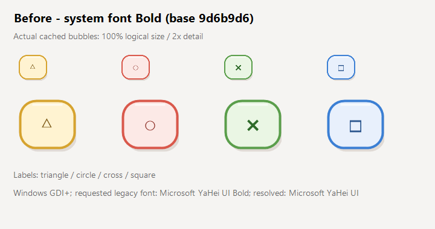
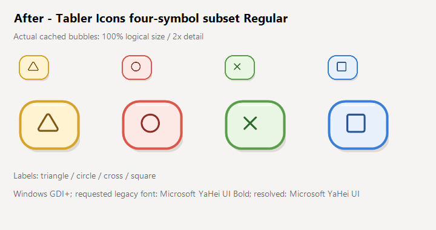

# DS5 面键字体前后对比

原先气泡与面板使用 `Microsoft YaHei UI` Bold 绘制 `△○×□`。四个字符属于普通数学/几何符号，并不保证成套图标的笔画一致；缺字时还会受 Windows 字体回退影响。

本次改用 Tabler Icons 3.35.0 outline 的四字形子集，原始图标使用统一 2 单位笔画；用 Regular 绘制，避免再次合成加粗。应用内仅嵌入这四个符号，详见 [字体来源、许可与生成方式](../../assets/fonts/README.md)。

## 示意图

以下为 Windows GDI+ **直接调用应用实际气泡绘制方法**生成的静态示意图，包含原尺寸（44 逻辑像素高）与 2 倍细节。不是用户设备截图，也不代表手柄实机验收。前后使用相同操作系统、相同画布、相同颜色和相同绘制参数，仅应用版本不同。

已在此 Windows 环境二次确认：旧版的「×」明显比其它三个符号更粗；新版四个符号采用同一套线性图标笔画。该环境实际解析到 Microsoft YaHei UI，并未整套回退为其它字体。

应用前（上游 `9d6b9d62c65a9ca0abe4ef3f251bcf6a77d9142c`）：



应用后：



## 维护者重新生成

Windows / .NET 8：

```powershell
dotnet run --project tools/PadSymbolPreview -c Release -- docs/dualsense-font/after.png "After - Tabler Icons four-symbol subset Regular"
dotnet run --project tests/PadInputChecks -c Release
```

生成应用前图片时，将 `tools/PadSymbolPreview` 复制到上述原版提交的独立工作目录，并在原版目录执行相同命令，将输出文件改为 `before.png`。工具直接读取应用的四个缓存气泡，没有另外绘制一套仿制图标。

图片底部记录旧字体的实际解析名称。Windows 语言包、字体版本和 DPI 会影响旧字体及其回退效果；修改后的四个符号使用应用内置字体。

## 验证记录

[Windows 自动验证与原始图片产物](https://github.com/Aloneblue9527/WuwaTappoNative/actions/runs/46111810862)：字体加载、四个字形轮廓、GC 后字体存活、气泡颜色/映射/长按去重、主题及 Xbox 回退等共 **1,350 项断言通过**。另有跨平台输入逻辑 **28 项断言通过**。字体连续生成两次 SHA-256 相同，确认可复现。

验证使用静态绘制和输入报告回放，未在本次更改中连接实体 DS5。字体数据通过主程序嵌入资源分发，不需要系统字体安装。
